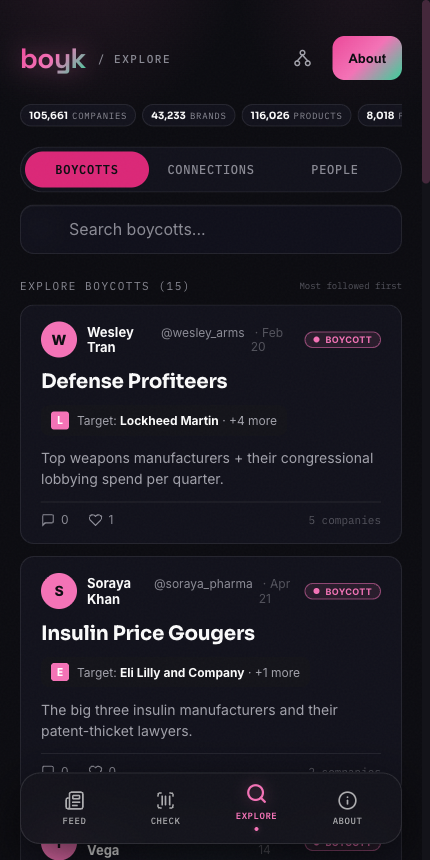
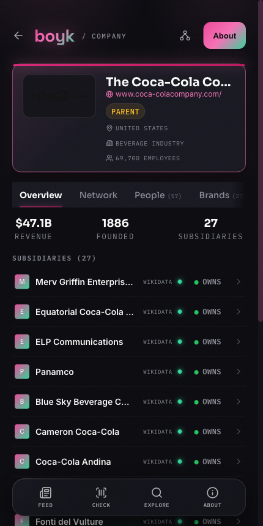
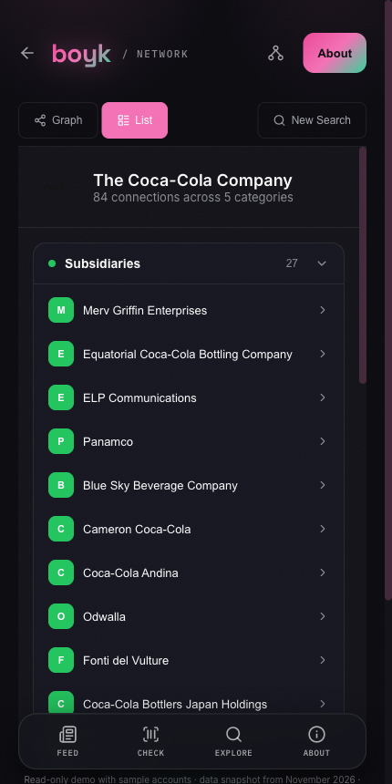
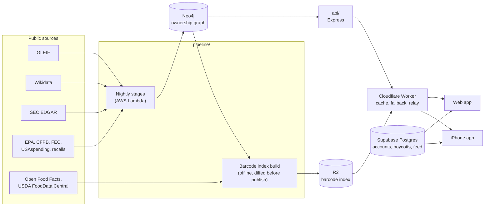

# Boyk

**See who owns the brands you buy, and organize boycotts around it.**

Boyk is a personal project by Daniel Freymann, built between January and November 2026. Search a
brand or scan a barcode and it shows the ownership chain up to the ultimate parent, with a source
on every link. Start a boycott of a company and it automatically covers that company's subsidiaries
and brands. A feed lets people post, follow each other and adopt each other's boycotts.

**Live demo: [boyk.org](https://boyk.org)** (read-only, see [Demo mode](#demo-mode))

| Boycotts                                  | Company page                             | Connections                                      |
| ----------------------------------------- | ---------------------------------------- | ------------------------------------------------ |
|  |  |  |

## What is in this repository

| Path                | What it is                                                                                       |
| ------------------- | ------------------------------------------------------------------------------------------------ |
| `src/`              | Web app: React 19, Vite, Tailwind CSS 4, TanStack Query                                          |
| `public/_worker.js` | Cloudflare Worker in front of the site: API cache, barcode lookup, error-report relay, demo mode |
| `api/`              | Graph API: Express on AWS App Runner, Cypher queries against Neo4j                               |
| `pipeline/`         | Data pipeline: Python on AWS Lambda, 20+ enrichment stages, plus the barcode index builder       |
| `ios/`              | iPhone app: SwiftUI, distributed through TestFlight                                              |
| `chrome-extension/` | Browser extension that warns you on the websites of companies you boycott                        |
| `supabase/`         | Postgres schema, row-level security, and Deno edge functions                                     |
| `scripts/demo/`     | The scripts that froze the live system into the read-only demo                                   |
| `e2e/`              | Playwright end-to-end tests                                                                      |

## How it fits together



The graph held about 718,000 nodes when it was frozen: 105,000 companies, 43,000 brands, 116,000
products, 8,000 people, and the enforcement, contract and complaint records attached to them.
Companies are keyed by LEI or Wikidata ID. Every ownership edge records where it came from and when
it was last confirmed.

## Engineering notes

Four problems from the project that say the most about how it was built. Longer write-ups are in
[`docs/engineering-notes.md`](docs/engineering-notes.md).

**A data bug that the build would have shipped silently.** The barcode index maps about 3 million
barcodes to the company that owns the brand. A rebuild that added a reviewed list of USDA owner
names reassigned 183 US Kit Kat barcodes from Hershey, the US licensee, to Nestlé. Nothing failed.
It was caught because publishing goes through a diff that groups every changed barcode by "from
company → to company", and that move stood out among about 15,000 legitimate ones. The cause was a
rule that treated any supporting record as enough: 2 licensed ice-cream records outweighed 144 that
named Hershey. The rule now requires an owner to account for at least 25% of a brand's records, and
it is applied in all three places that had the same flaw. Coverage went from 20.3% to 22.7% of
barcodes. See `pipeline/tools/off-ingest/`.

**Error reports that never arrived.** Sentry showed no errors from the web or iPhone app, which
looked like good news. It was a network problem: some ISPs block `sentry.io` by TLS hostname, so
any user on such a network was invisible to monitoring. The Worker now relays error reports
through the site's own domain. The relay only accepts POSTs for this project's three Sentry
projects, so it cannot be used as an open proxy. See `/sentry-relay` in `public/_worker.js`.

**Pipeline stages that ran past the Lambda time limit.** Nightly batches were dying at exactly 900
seconds. Checking the time budget when a stage starts cannot stop a stage that overruns once it is
running, and raising an error inside one worker thread did not help either, because leaving a
thread pool waits for every queued task, and those tasks were mostly sleeping in a rate limiter.
The fix puts the deadline check in the one progress callback every stage already calls, and
hitting it flips a flag that turns pending requests and rate-limit waits into no-ops. A stage that
runs out of time is now recorded as cut short instead of crashing the whole batch. See
`pipeline/etl/enrichment/`.

**Two companies with the same name are not the same company.** Name-matched enrichment had stamped
one Wikidata ID onto several distinct legal entities: twelve different "FNB Corporation" entities
with twelve different LEIs shared a single ID. The uniqueness constraints meant to prevent this had
failed to create and logged the failure at debug level, so they had never been enforced. The
rebuild tool resolves each collision by rule (distinct LEIs are never merged, ghosts without one
are folded into the winner), and the writer now refuses to stamp an ID another node already holds.
See `pipeline/tools/rebuild/`.

## Demo mode

The site at boyk.org has no database or API server behind it. Before the backend was shut down,
`scripts/demo/` saved everything the site needs:

1. `export-graph.py` exports every node and relationship in the graph.
2. `snapshot-graph.py` saves the API's response for every company, brand, person and barcode,
   about 172,000 lookups, as one JSON file each.
3. `build-search-index.py` builds a search index: each name is filed under the first two letters
   of each of its words, so a search reads one small file.
4. `snapshot-social.mjs` records the sample accounts, posts and boycotts, and `curate-social.py`
   tidies them.
5. `upload-snapshot.py` puts the files in Cloudflare R2.

The Worker answers `/neo4j-api/*` from those files, and the Supabase client is given a `fetch`
that answers from the recorded social data (`src/lib/demoBackend.js`). The rest of the app is
unchanged and does not know the difference. Sign-in, posting and messaging are turned off, and the
accounts and posts shown are sample data.

Building with `VITE_LIVE_BACKEND=true` and setting `LIVE_BACKEND=true` on the Worker restores the
live backend.

## Running it

```bash
npm install
npm run dev      # http://localhost:5173, demo mode, no configuration needed
npm test         # unit tests (Vitest)
npm run lint
npm run build
```

In local development the social pages work from the bundled snapshot. Graph pages need the Worker
and its R2 bucket, so they are easiest to see on the live demo.

The pipeline has its own 257 tests (Python 3.10 or later):

```bash
cd pipeline
pip install -r etl/requirements.txt
pytest etl/tests -q
```

## Data sources and licenses

Ownership and company data come from [GLEIF](https://www.gleif.org) (CC0),
[Wikidata](https://www.wikidata.org) (CC0), SEC EDGAR and other US federal records (public
domain). Product data comes from [Open Food Facts](https://world.openfoodfacts.org) (ODbL) and
USDA FoodData Central (public domain). Logos are served by [Logo.dev](https://logo.dev). See
[`docs/etl-data-sources.md`](docs/etl-data-sources.md) for the full list.
